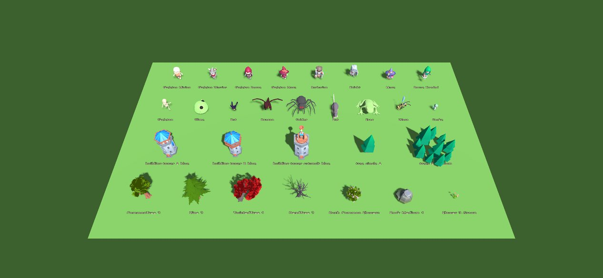
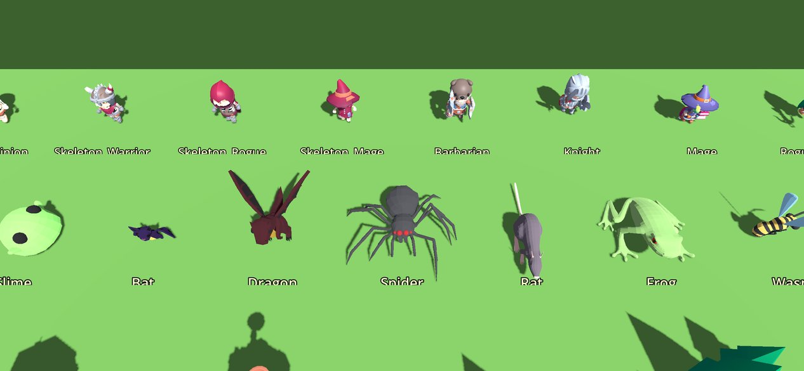
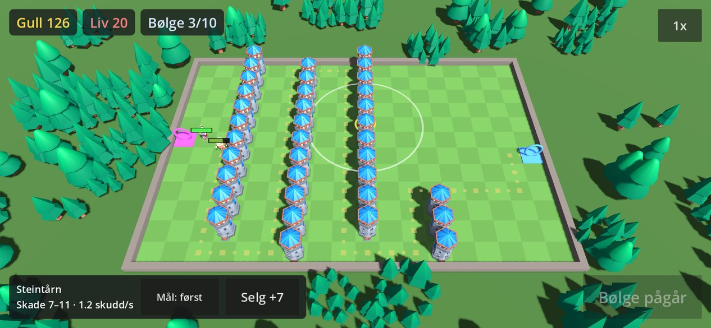
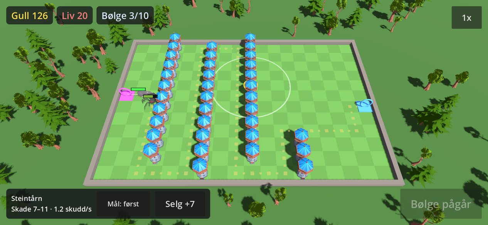
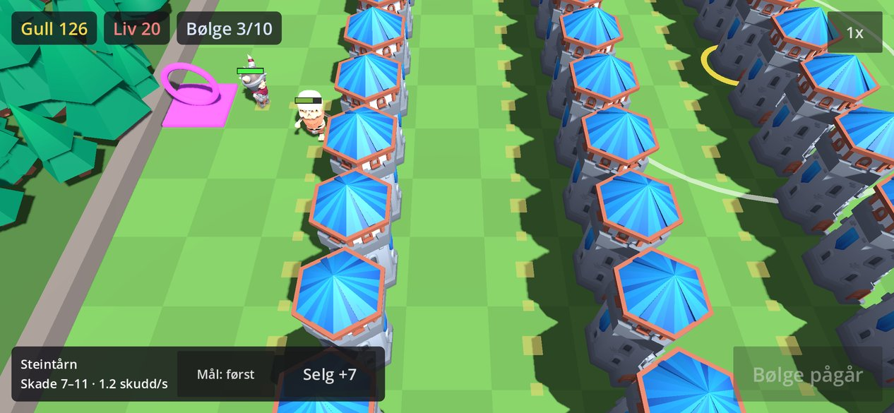
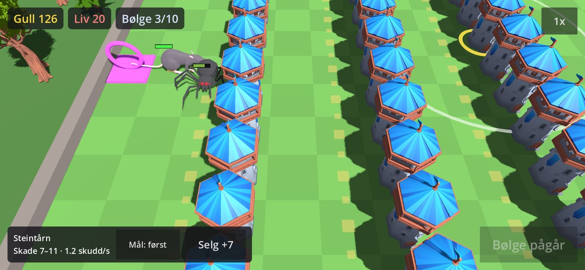

# 3D-grafikk: kandidater og anbefaling

Del av #7. Målet er en WC3-lignende stil: 3D med lite detaljer, mettede farger, tydelige silhuetter og et skrått kamera. All grafikk skal være vår egen eller ha en lisens som lar oss sjekke den inn i et **offentlig** repo, siden GitHub Pages-forhåndsvisningen krever det.

## Lisens

- **KayKit** (Kay Lousberg): CC0. Ligger på GitHub under `KayKit-Game-Assets`.
- **Quaternius, eldre pakker**: CC0 ifølge itch-sidene, for eksempel *LowPoly Animated Monsters*, *Easy Animated Enemies* og *Stylized Nature MegaKit*.
- **Quaternius, nyere pakker** (fra august 2026, blant annet *Bestiary*): bruker **Quaternius Asset License (QAL)**. QAL tillater bruk i spill, men forbyr at selve filene deles videre. De kan derfor **ikke** sjekkes inn i dette repoet.
- **Kjøpt grafikk** (Synty, Unity Asset Store, Mixamo): forbyr som regel at filene deles videre. Samme problem som QAL.

Lisensen sjekkes for hver pakke og loggføres i `CREDITS.md` når vi tar den i bruk.

## Sammenligning

`scripts/fetch-art-candidates.sh` henter kandidatene til `game/art_candidates/` (ignoreres av git). Det trenger nettverkstilgang til `github.com`, `itch.io` og `quaternius.itch.io`. Google Drive-lenkene på quaternius.com stopper nedlasting uten innlogging med «Quota exceeded», så scriptet bruker itch.

```bash
scripts/fetch-art-candidates.sh
scripts/screenshot.sh lineup.png res://tools/art_lineup.tscn 30 2532x1170
MOCK=kaykit scripts/screenshot.sh mock.png res://tools/art_mock.tscn 40 2532x1170
```

- `tools/art_lineup.tscn`: alle kandidatene på rad med spillets kameravinkel, skalert til en målhøyde. `LINEUP_DIST=8 LINEUP_Z=2.6` gir nærbilde av fiendene.
- `tools/art_mock.tscn`: demo-scenen med placeholder-figurene byttet ut. `MOCK=kaykit|quaternius` velger sett, og `MOCK_DIST=7` zoomer inn ved start.




| KayKit-skjeletter og KayKit-trær | Quaternius-dyr og Quaternius-trær |
|---|---|
|  |  |
|  |  |

Tårnet er `building_tower_A/B_blue` fra KayKit Medieval Hexagon i begge settene.

## Tall

Trekanter og animasjoner er målt i Godot, og antall ben er lest fra glTF-filene.

| Modell | Trekanter | Ben | Animasjoner | Kommentar |
|---|---:|---:|---|---|
| KayKit Skeleton_Minion/Warrior/Rogue/Mage | 4,6–5,9k | 41 | 95 (felles rigg) | Chibi-figurer: høye, smale og små ovenfra |
| KayKit Barbarian/Knight/Mage/Rogue | 5,7–7,0k | 41 | 76 | Aktuelle som helter |
| Quaternius Skeleton, Slime, Bat, Dragon | 1,0–1,8k | – | gå/løp/fly, angrep, død | FBX, importeres direkte (ufbx) |
| Quaternius Spider, Rat, Frog, Wasp, Snake | 1,6–4,9k | – | gå/løp, angrep, død (frosken har bare hopp, slangen mangler død) | Brede silhuetter som er lette å lese |
| KayKit-tårn (A, B, katapult) | 2,1–2,9k | – | – | 4 team-farger og ett felles teksturatlas |
| KayKit-trær | 50–480 | – | – | Ingen gjennomsiktighet, svært lette |
| Quaternius Stylized Nature-trær | 3,6–9,6k | – | – | Bladverk med alpha (overdraw på mobil) |

## Funn

1. **Fiendene er for små ved standard zoom.** Med kameraavstand 19 og hele brettet på 18×12 ruter i bildet blir en fiende som er én rute høy bare ca. 11 pt på iPhone. Målet i #7 er minst 40 pt. Vi må gjøre fiendene ca. 1,5 rute store, starte nærmere inn (avstand ca. 10–12), eller begge deler. Dette gjelder uansett hvilken pakke vi velger.
2. **Dyr og monstre leses bedre enn menneskefigurer** ovenfra med 55° helling. Edderkopp, rotte og slim har brede silhuetter. Chibi-skjelettene blir små prikker.
3. **KayKit-tårnene og -trærne henger godt sammen** og bruker ett felles teksturatlas, så de kan dele ett materiale (bra for draw calls). Trærne fra Quaternius Stylized Nature er mer detaljerte, bruker alpha i bladverket og passer dårlig med tårnene.

## Anbefaling

- **Tårn, trær og stein:** KayKit Medieval Hexagon.
- **Vanlige fiender:** de eldre CC0-pakkene fra Quaternius (dyr og monstre med gå- og dø-animasjon).
- **Bosser og senere helter:** KayKit Skeletons og Adventurers.
- **Portaler, prosjektiler og stipynt:** Blender-script (`bpy`) i samme palett.
- **En felles shader** (myk lambert, svak rim og maske for team-farge) som binder stilene sammen.
- **Ikke** QAL-pakker eller kjøpte pakker så lenge repoet er offentlig.

## Åpne spørsmål

- Skal lesbarheten løses med større fiender, et kamera som starter nærmere inn, eller begge?
- Tema for fiendene: dyr og monstre som vanlige fiender og skjeletter som bosser, eller noe annet?
